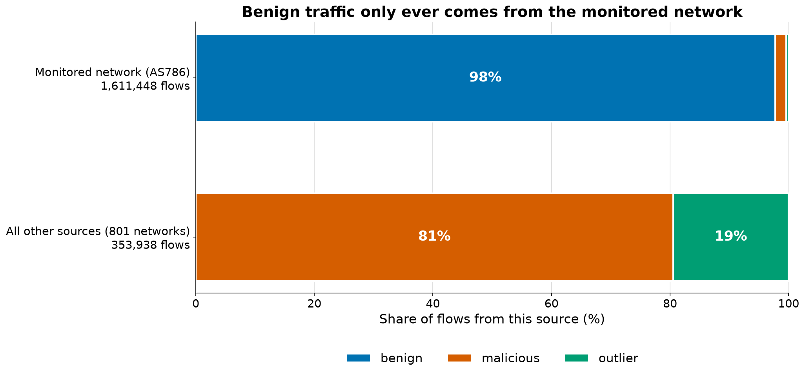
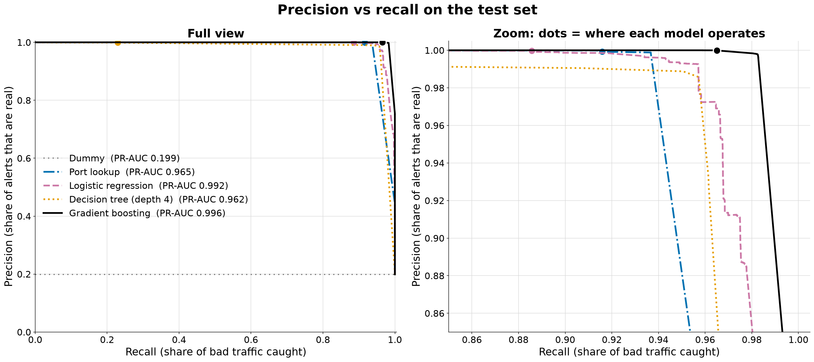

# Network intrusion detection case study

A simple end-to-end solution for the REPAY case study: a model that scores network flows by how suspicious they
look, served by an API. This README follows my process in eight stages. Each one says what I did, what I found and
what I decided, and links to the work. **In short:** on held-out traffic the served model catches **96.5%** of bad
flows with about **40 false alarms a day**, inside a budget of ~157, and it scores ~75,000 flows a second in batches.

## 1. The ask

The brief: build a **simple, end-to-end** solution on network flow records labelled as outlier or not. Train a
basic model, expose it through an API, and be ready to explain the thinking: the data, the modeling choices, the
evaluation, the API design, and how to make it production-ready. The time budget is **2 to 4 hours** (about 30
minutes for the model, 1 hour for the API, 1 to 1.5 hours to think it through). The brief says a very simple model
is fine, and that it cares more about how I think than about how accurate the model is.

**My problem statement.** A security team watching the network around a payment platform cannot inspect every
connection, so it needs a score that ranks network flows by how suspicious they look. The goal is to catch as much
malicious or unusual traffic as possible while keeping false alarms within what a small analyst team can review
(about 157 a day here), and to score fast enough to keep up with traffic bursts. Success is the share of bad
traffic caught inside that false-alarm budget, not accuracy.

## 2. Understand the data

→ [`notebooks/01_eda.ipynb`](notebooks/01_eda.ipynb)

I checked the data before any model, one question at a time: question → what I found → decision. It is the
**LUFlow** dataset: 1,965,386 flows from one day of one university network, with **three labels** (benign 80.1%,
malicious 16.0%, outlier 3.8%). The labels come from matching IP IDs against threat intelligence, so `src_ip` alone
guesses the label 98% of the time, and 99% of benign flows are internal to the monitored network. **Decided:** drop
the IPs, the source port and the timestamps as inputs; drop only the 1,039 exact duplicate rows; log-transform the
heavy-tailed counts; group the 20,409 destination ports.



*Benign traffic only comes from the monitored network, so the IPs would give the label away.*

## 3. Business framing

→ [`docs/business_framing.md`](docs/business_framing.md)

The score is for a security analyst. A false alarm costs analyst time and can block a real merchant; a missed attack
can mean a breach, fraud loss and PCI DSS exposure. The target is **"not benign"** (malicious + outlier), because
known attacks must be caught too. **Success = recall inside a false-alarm budget** of 0.01% of benign flows (~157 a
day, what a small team can review), within a **speed budget** of 4,500 flows a second per process (10x the busiest
minute in the data).

## 4. Model development

→ [`notebooks/02_model_development.ipynb`](notebooks/02_model_development.ipynb) · [`src/train.py`](src/train.py)

I split the flows 60/20/20: fit on train, choose each model's threshold and the model on validation, use the test set
once. Five models, simplest first, each with the lowest threshold that stays inside the budget on validation.
**Selection rule:** highest validation recall inside the budget, among models that meet the speed budget. Gradient
boosting wins by 4.7 points and holds on test:

| Model | Validation recall | Test recall | Test false alarms / day | Test PR-AUC | Flows / s, batches of 1,000 | One flow, p95 | File |
|---|---|---|---|---|---|---|---|
| Dummy (floor) | 0% | 0% | 0 | 0.199 | (no work) | (no work) | 0.0 MB |
| Port lookup (rule) | 91.8% | 91.6% | ~280 | 0.965 | ~1.2 million | 0.3 ms | 0.3 MB |
| Logistic regression | 88.9% | 88.6% | ~120 | 0.992 | ~100,000 | 9 ms | 0.8 MB |
| Decision tree (depth 4) | 22.8% | 22.9% | ~105 | 0.962 | ~100,000 | 9 ms | 0.8 MB |
| **Gradient boosting (served)** | **96.5%** | **96.5%** | **~40** (95% range 20-79) | **0.996** | **~75,000** | 9 ms | 1.2 MB |

The test set is 392,870 flows, the same as in earlier versions. Speed is measured on one CPU thread through the
whole pipeline: every model is far above the budget in batches, but one flow at a time would manage only ~110 a
second, so the service scores small batches. Recall by label: malicious 96.6%, outlier 96.3%.



*By area the learned models look close; at the operating point (dots), boosting catches the most with the fewest
false alarms.*

Before trusting the number:

- **Not memorizing:** recall is 95.3% on test flows that repeat a training flow and 97.1% on new ones.
- **Later traffic:** trained on the first 60% of the day, with the threshold set on a 25-minute burst, it keeps
  99.1% recall but raises ~2,060 false alarms a day (13x the budget). The threshold must be re-set on recent traffic,
  and the daily count monitored.
- **What drives it:** mostly the destination port. On this network, port 9200 (internal logging) is two thirds of
  benign traffic.
- **Two mistakes caught by review** (in an earlier version): removing look-alike rows hid ~126,000 false alarms a
  day, so now only exact copies are dropped; and benign port-9200 flows got runaway scores of 1.0, fixed with
  `l2_regularization=1.0` (~470 → ~35 false alarms a day). See decisions 2 and 12.

## 5. Serving

→ [`src/api.py`](src/api.py) · [`tests/`](tests/)

A FastAPI service loads the model once at startup. Every answer carries the **score, the threshold and the model
version**, so analysts can rank alerts and trace every answer. Bad input gets a **422 that names the field, never a
500**, and the data is never echoed back; logs keep a request id and the latency, never the body. 12 tests run
against a tiny real model, so they need no data, and CI runs them on every push.

| Method | Path | Returns |
|---|---|---|
| GET | `/health` | `{"status": "ok", "model_loaded": true}`, or 503 without a model |
| GET | `/model/info` | version, inputs, threshold and how it was chosen, test results |
| POST | `/predict` | one flow → `is_outlier`, `score`, `threshold`, `model_version` |
| POST | `/predict/batch` | `{"flows": [...]}`, 1 to 1,000 flows → one result per flow, plus `flagged` |

## 6. Production design

→ [`docs/production.md`](docs/production.md)

Near-real-time scoring in micro-batches, behind a load balancer on AWS (Kinesis, ECS Fargate, the SageMaker model
registry, Bedrock). The container loads the approved model at startup; a new model goes through shadow mode and a
canary by sensor, with one-step rollback. Monitoring has concrete alarms: false alarms a day vs the budget, input
drift (PSI), the score distribution, latency, errors and analyst-confirmed precision, with retraining weekly or on
drift.

## 7. Agentic reviewer (design only)

→ [`docs/agentic_review.md`](docs/agentic_review.md)

An LLM agent (for example Claude on AWS Bedrock) triages incidents after the model flags them. It gathers evidence
with read-only tools and returns a verdict (likely attack, likely false alarm, or needs a human) with a plain-English
summary. It stays off the scoring path, humans approve any blocking, and it cannot find attacks the model missed. It
must first prove itself on past alerts in shadow mode: the share of real attacks it would dismiss must be near zero.

## 8. With more time

- **Unseen attackers:** hold out whole source networks, to test new attackers, not just new flows.
- **Other traffic:** other LUFlow days and other networks; legitimate inbound traffic (HTTPS, SSH) in the benign
  data; the threshold re-set on recent, representative traffic.
- **Better scores:** calibrate them, and set the threshold from the cost of each error.
- **Per-source features:** for example how many ports a source touched in the last minute. They need per-host IPs:
  on this data they would bring the IP leak back.
- **Error analysis** of the ~2,730 missed test flows, starting with the empty one-packet TCP probe that looks the
  same whether it is benign or bad.

**Limits of these results:** one day of one academic network; 99% of benign flows are internal to it; labels come
from IP reputation, not from analysts; 20% bad traffic is far more than real traffic has; and scores rank flows but
are not calibrated probabilities.

## How to run

Needs Python 3.12+ and the dataset CSV in `data/raw/` (one file), or `DATA_PATH` pointing to it.

```bash
python3 -m venv .venv && source .venv/bin/activate && pip install -r requirements.txt
```

Train the five models, choose the threshold and the model, and save `models/model.joblib` and
`models/metrics.json` (about 1 minute):

```bash
python -m src.train
```

Run the API; the interactive docs are at http://127.0.0.1:8000/docs:

```bash
uvicorn src.api:app --reload --reload-dir src
```

Run the tests (12 tests, about 1 second, no data or trained model needed):

```bash
pytest -q
```

Score one flow:

```bash
curl -s -X POST http://127.0.0.1:8000/predict -H 'Content-Type: application/json' -d @docs/examples/outlier_flow.json
```

```json
{"is_outlier":true,"score":0.9998959532907613,"threshold":0.9100555941870925,"model_version":"20261029-002430"}
```

`model_version` is the UTC time of the training run, so yours will differ. To re-run both notebooks after training:

```bash
jupyter nbconvert --to notebook --execute --inplace notebooks/01_eda.ipynb notebooks/02_model_development.ipynb
```

To build the serving image after training (Docker was not installed on the machine this was built on, so the image
itself is untested):

```bash
docker build -t flow-api . && docker run -p 8000:8000 flow-api
```

## Files

| Path | What it is |
|---|---|
| `notebooks/01_eda.ipynb` | Stage 2: the data, question → finding → decision (figures 01-04) |
| `docs/business_framing.md` | Stage 3: users, error costs, target, success metric, impact |
| `notebooks/02_model_development.ipynb` | Stage 4: split, five models, thresholds, speed, choice, test, trust checks (figures 05-06) |
| `src/config.py` | Paths, columns, target, split, alert and speed budgets |
| `src/features.py` | Load the data, drop exact duplicates, build the target, sort by time, the preprocessing pipeline |
| `src/train.py` | The reproducible training script: saves the model and `metrics.json` |
| `src/api.py` | Stage 5: the FastAPI service |
| `tests/` | API tests against a tiny real model, so no data is needed |
| `.github/workflows/ci.yml` | Runs the tests on every push |
| `docs/production.md` | Stage 6: production design |
| `docs/agentic_review.md` | Stage 7: agentic reviewer design |
| `docs/decisions.md` | Every decision: alternatives, why, tradeoff |
| `docs/examples/` | Two example requests (a normal and an outlier flow), shown in `/docs` |
| `reports/figures/` | The six figures from the notebooks |
| `Dockerfile`, `requirements-api.txt`, `.dockerignore` | The serving image |
| `requirements.txt`, `pytest.ini` | Pinned packages; test settings |

## How this was built

I used Claude Code as a coding assistant (the brief allows AI tools). I set the direction, reviewed every step, and
own every decision: each one is in [`docs/decisions.md`](docs/decisions.md), with the alternatives and the tradeoff.

Development history was squashed into one commit before sharing.
