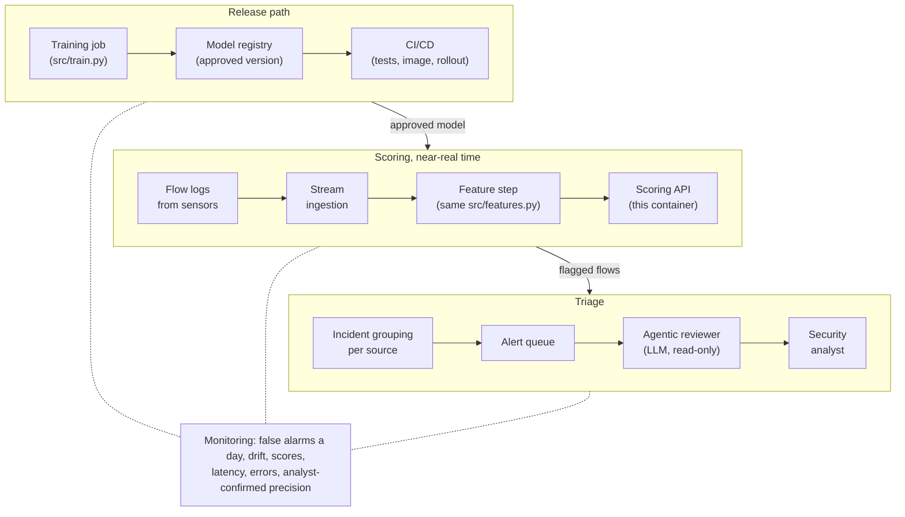

# Production design

How this would run at a payments company. It is a design: section 7 separates what exists in this repo from what
does not. `[N]` points to a row in [`decisions.md`](decisions.md).

## 1. The system

The feature step checks each flow record and builds the 10 inputs with the same `src/features.py` as training. The
API scores small batches, flagged flows become one incident per source, and the agentic reviewer
([`agentic_review.md`](agentic_review.md)) adds evidence before an analyst decides. Analyst decisions become labels
for the next training run.

## 2. Near-real-time scoring and speed

A flow record arrives only after its connection ends, so nothing waits for the score: the service is built for
throughput and time to alert, not for single-flow latency [6].

| Measure | Value |
|---|---|
| Busiest minute in the data | 26,695 flows (17:01 UTC), about 445 a second |
| Speed budget, one process | 4,500 flows a second |
| Served model, batches of 1,000, one CPU thread | about 75,000 flows a second |
| Served model, one flow at a time | about 9 ms per call: only about 110 flows a second |
| Through the API (HTTP + validation) | one flow about 15 ms; 1,000 flows about 25 ms |

- **Micro-batches:** the fixed cost per call dominates, so the stream consumer sends up to 1,000 flows or one second
  of traffic, whichever comes first.
- **Scaling:** the service keeps no state, so more containers go behind a load balancer, autoscaled on CPU and
  stream lag; at least two for availability.
- **Time to alert:** target 95% of alerts in the queue within 60 seconds of the flow ending. Most of that is the
  sensor's export timer and the stream; batching adds at most a second.

## 3. Where it runs

**AWS:** Kinesis Data Streams for flow records, this container on ECS Fargate behind a load balancer, S3 for data,
SageMaker for training jobs and the Model Registry, Bedrock for the agentic reviewer, CloudWatch for alarms, Secrets
Manager for credentials. **Why:** the container runs on ECS unchanged (a SageMaker endpoint would need an adapter for
its `/ping` and `/invocations` contract), and data, models and the LLM stay in one account, which keeps the PCI DSS
scope in one place. **Alternatives:** Databricks with MLflow, or Azure (Event Hubs, Container Apps, Azure ML).

## 4. Deployment

- **Image and CI:** the `Dockerfile` builds a small non-root image with serving-only requirements. Every push runs
  `pytest -q` (`.github/workflows/ci.yml`; no data needed [18]); a merge also builds the image, smoke-tests
  `/health` and `/predict`, and pushes it to ECR.
- **Registry and versioning:** each training run registers its bundle with its metrics, data hash and git commit,
  and a person approves promotion. The image holds only code: **at startup the container loads the approved model**
  into `MODEL_PATH` (today the model is copied into the image) [19].
- **Shadow, then canary:** first shadow (live traffic, no alerts, compared with the current model). Then a canary as
  an experiment: randomized by sensor, not by flow, so an incident is never split; primary metric analyst-confirmed
  incidents per analyst hour; guardrails false alarms within budget and p95 latency; at least two weeks.
- **One-step rollback:** move "approved" back to the previous model and restart; code rolls back to the previous
  image tag.
- **Config and secrets:** the threshold travels inside the model bundle; settings come from environment variables
  and credentials from Secrets Manager, never from the image or the repo.

## 5. Monitoring and retraining

| Signal | Alert when |
|---|---|
| False alarms a day vs the ~157 budget | Above 2x the budget on a day, or above it 3 days in a row (the time-based check showed a 13x jump [13]) |
| Input drift: PSI vs training | PSI above 0.2 on the `dest_port` groups or `bytes_out`, or the share of unseen ports doubles |
| Score distribution | Daily alert rate 3 standard deviations from its 4-week mean, or one protocol/port group making up most top scores [12] |
| Latency | p95 above 100 ms per batch of 1,000 (about 25 ms today), or stream lag above 30 seconds |
| Error rate | 5xx above 0.1%, any 503 for over a minute, or 422 above 1% (an upstream format change) |
| Analyst-confirmed precision | Weekly value 10 points below its shadow-mode baseline |

**Retraining trigger:** weekly, and right after any drift or false-alarm alert. A challenger replaces the champion
only if, on the same recent time-ordered window, it catches more inside the budget with false alarms within it. The
threshold is always re-set on recent, representative traffic [13]. Missed attacks never show up as alerts, so
recall is also checked on a reviewed random sample of unflagged traffic and on red-team traffic.

## 6. Validation, consistency and security

- **Validation before scoring:** the API refuses bad records with a 422 [15]. Per batch, the feature step tracks the
  share of invalid records, unseen ports and capped counters; a jump raises an alert instead of being scored quietly.
- **Train/serve consistency:** preprocessing lives inside the saved pipeline, and a test checks that the API scores
  exactly like it [7]. Sensors must compute bytes, packets, entropy and timing as in the training data, so a new
  sensor version is checked like a new data source.
- **Security:** API keys or mutual TLS, rate limits at the load balancer, the existing 1,000-flow batch cap, no
  request bodies in logs [17] (uvicorn's access log must be configured too), an audit trail of model version, score
  and threshold for every alert, and models loaded only from the registry (a joblib file can run code).
- **PCI DSS:** this monitoring supports the requirements to log and monitor access to the cardholder data
  environment and to use intrusion detection, so its own logs and data follow the same access and retention rules.

## 7. Exists today vs design only

| Exists today | Design only |
|---|---|
| `src/train.py`: five models, a speed check, one saved bundle | Stream ingestion and the feature step |
| `src/features.py`, inside the saved pipeline | Incident grouping, alert queue, agentic reviewer |
| `src/api.py`: validation, batches of up to 1,000, logs without payloads | Model registry, approval, loading at startup |
| API tests with a parity check, run in CI | Shadow and canary rollout, rollback |
| `Dockerfile` (not built here: Docker was not installed) | Monitoring, alarms and retraining |
| Time-based check showing threshold drift (notebook 02) | Authentication, rate limits, audit trail |
